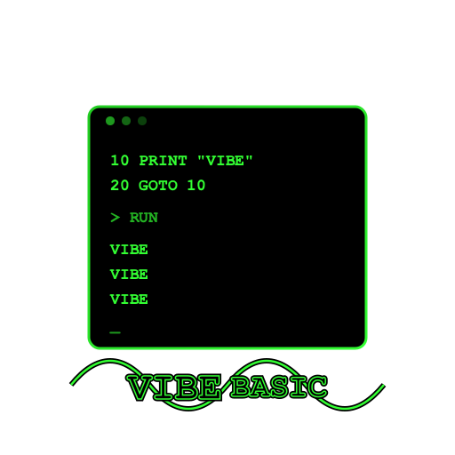

<p align="center">
  
</p>

# Vibe Basic Interpreter

A BASIC language interpreter written in Rust, implementing a subset of classic MS-BASIC (GW-BASIC style) with line-numbered programs, arithmetic expressions, string handling, and control flow.

The full language specification — EBNF grammar, semantic explanations, and example programs with expected output — is in [`vibe-basic-syntax.txt`](vibe-basic-syntax.txt).

Co-Authored-By: Claude Opus 4.6.  All code generated by Claude Code; no hand editing of the code was done (except in some of the BASIC examples).  See [`PRD.md`](PRD.md) for prompts.  No agents.md or claude.md file was used.

Pirate Island adapted from David Meny original at https://unbox.ifarchive.org/?url=/if-archive/games/source/basic/pirate.zip, Copyright 1985, Menco, Inc.

## Language Features

### Statements

| Statement | Syntax | Description |
|-----------|--------|-------------|
| LET | `[LET] var = expr` | Assign a value (`LET` keyword is optional) |
| PRINT | `PRINT [expr_list]` | Output values to the screen |
| INPUT | `INPUT ["prompt" (;\|,)] var {, var}` | Read one or more comma-separated values into variables (`;` appends `?`, `,` suppresses it); too few/many values or a text string for a numeric var triggers "Redo from start" |
| IF/THEN/ELSE | `IF expr THEN clause [ELSE clause]` | Conditional (clause is a line number or statement) |
| GOTO | `GOTO linenum` | Unconditional jump |
| FOR/NEXT | `FOR var = start TO end [STEP val]` | Counted loop |
| GOSUB | `GOSUB expr` | Call subroutine (target may be a computed expression) |
| ON...GOSUB | `ON expr GOSUB n1, n2, ...` | Computed subroutine dispatch |
| RETURN | `RETURN [expr]` | Return from subroutine (optional target line number) |
| DEF FN | `DEF FNname[(params)] = expr` | Define a single-line user function |
| DATA | `DATA item, item, ...` | Inline data values |
| READ | `READ var [, var ...]` | Read the next DATA value into variables |
| RESTORE | `RESTORE [linenum]` | Reset the DATA pointer |
| DIM | `DIM var(n) [, var(m, p)]` | Dimension arrays (subscripts are 0-based) |
| ERASE | `ERASE var [, var ...]` | Remove arrays so they can be re-dimensioned |
| LOCATE | `LOCATE [row][,[col][,[cursor][,[start][,stop]]]]` | Position cursor on screen |
| CLS | `CLS [n]` | Clear the screen |
| COLOR | `COLOR [fg][,[bg][,border]]` | Set text foreground/background colors |
| REM | `REM text` or `' text` | Comment (ignored by interpreter) |
| END | `END` | Terminate the program |
| STOP | `STOP` | Suspend execution and enter the debugger (like a breakpoint); preserves all state |
| CONT | `CONT` | Resume execution after a STOP (as a statement, a no-op; in the debugger, equivalent to RUN) |

Multiple statements can appear on one line separated by colons (e.g., `10 X = 0 : Y = 10`).

### Expressions

Operator precedence from lowest to highest:

| Precedence | Operators |
|------------|-----------|
| Lowest | `OR` |
| | `XOR` |
| | `AND` |
| | `NOT` (unary) |
| | `=  <>  <  >  <=  >=` |
| | `+  -` |
| | `*  /` |
| | `^` (exponentiation) |
| Highest | `-` (unary negation) |

- All binary operators are left-associative.
- Comparisons return `-1` (true) or `0` (false), MS-BASIC style.
- `AND`, `OR`, `XOR`, `NOT` operate as bitwise integer operations.
- `+` performs string concatenation when both operands are strings.
- String comparison is supported with all comparison operators.

See the [full specification](vibe-basic-syntax.txt) for the complete EBNF grammar.

### Built-in Functions

| Category | Functions |
|----------|-----------|
| Numeric | `INT` `ABS` `SQR` `RND` `EXP` `LOG` `SGN` `SIN` `COS` `TAN` `ATN` `FIX` `CINT` `CSNG` `CDBL` |
| String/Substring | `LEN` `LEFT$` `RIGHT$` `MID$` `INSTR` |
| Conversion | `ASC` `CHR$` `STR$` `VAL` `HEX$` `OCT$` |
| Formatting | `STRING$` `SPACE$` `SPC` `TAB` |
| Binary Data | `MKI$` `MKS$` `MKD$` `CVI` `CVS` `CVD` |

See the [full specification](vibe-basic-syntax.txt) for detailed parameter descriptions and behavior.

### Variables

Variable names start with a letter and may contain letters, digits, and underscores. Names are case-insensitive (stored uppercase). An optional type sigil indicates the type:

- `$` — string, `%` — integer, `!` — single-precision, `#` — double-precision

### Arrays

Arrays are declared with `DIM` and support multiple dimensions with 0-based subscripts. Using an array without `DIM` auto-dimensions it with a maximum subscript of 10. See the [full specification](vibe-basic-syntax.txt) for details.

### PRINT Formatting

- **Semicolon** (`;`) — suppresses spacing; next output continues on the same line
- **Comma** (`,`) — advances to the next 14-character tab zone
- **No separator at end** — prints a newline after the last item

## Project Structure

```
src/
├── main.rs          — CLI entry point: reads .bas files, supports --debug flag
├── token.rs         — Lexer/tokenizer: converts source text into tokens
├── expr.rs          — Expression parser: builds expression parse trees
├── eval.rs          — Evaluator: stack-based iterative expression evaluator
├── ast.rs           — Statement/program parser: parses tokens into an AST
├── interpreter.rs   — Interpreter: executes BASIC programs with full control flow
└── debugger.rs      — Debugger: interactive step-through debugging REPL
tests/
└── integration.rs   — Runs the example .bas files via the CLI (non-debug and --debug modes)
scripts/
├── setup-cross-compile.sh — Install cross-compilation toolchains and configure Cargo
└── build.sh                — Build release binaries for native and/or cross-compile targets
```

## Building

Requires Rust (edition 2021). Build with:

```sh
cargo build
```

For a release build:

```sh
cargo build --release
```

Or use the build script, which builds a release binary for the native platform:

```sh
scripts/build.sh
```

## Cross-compilation

Two scripts in the `scripts/` directory automate cross-compilation setup and building. They detect the host OS and install the appropriate toolchains.

### Supported targets by host OS

Mac supports building all current targets, so it is the preferred development environment.

| Host OS | Native Target | Cross-compile Targets |
|---------|--------------|----------------------|
| macOS | `aarch64-apple-darwin` or `x86_64-apple-darwin` | `x86_64-unknown-linux-gnu`, `x86_64-unknown-linux-musl`, `x86_64-pc-windows-gnu`, `aarch64-pc-windows-gnullvm` |
| Linux | `x86_64-unknown-linux-gnu` | `x86_64-pc-windows-gnu`, `aarch64-pc-windows-gnullvm` |
| Windows | `x86_64-pc-windows-msvc` or `aarch64-pc-windows-msvc` | *(native only)* |

### One-step build for all targets

Run `build.sh` to build a release binary for the native target:

```sh
scripts/build.sh
```

To also build all cross-compilation targets (installs required toolchains if not already present):

```sh
scripts/build.sh --all
```

Binaries are placed in `target/<target>/release/`.

### Setup only

To install cross-compilation dependencies without building, run the setup script on its own. It is idempotent and safe to run multiple times:

```sh
scripts/setup-cross-compile.sh
```

## Running

Pass a `.bas` file as an argument:

```sh
cargo run -- examples/hello.bas
```

Or use the compiled binary directly:

```sh
./target/release/vibe-basic myprogram.bas
```

### Debug Mode

Launch the interactive debugger with the `--debug` flag:

```sh
cargo run -- --debug examples/primes.bas
```

#### Remote Debug Mode

To keep debugger traffic separate from the BASIC program's stdin/stdout, use `--debug-port` to have the debugger listen on a TCP port:

```sh
cargo run -- --debug --debug-port 9000 examples/primes.bas
```

Then connect from another terminal with a tool like `nc` (netcat) or `telnet`:

```sh
nc 127.0.0.1 9000
```

Debug commands and output flow over the TCP connection while the program's `INPUT` and `PRINT` continue to use stdin/stdout in the original terminal.

The debugger provides a REPL with the following commands:

| Command | Description |
|---------|-------------|
| `STEP` | Execute one BASIC line |
| `RUN` | Continue execution until a breakpoint, STOP, or END |
| `CONT` | Resume execution (same as RUN) |
| `LIST` | Print the entire program listing |
| `LIST n` | Print the program starting from line number n |
| `LIST n m` | Print program lines from n through m (inclusive) |
| `GOTO n` | Jump to line number n |
| `BREAK AT n` | Set a breakpoint at line number n |
| `BREAK IF expr` | Set a conditional breakpoint |
| `LET var = expr` | Modify a variable during execution |
| `PRINT expr` | Evaluate and print an expression |
| `var = expr` | Shorthand for `LET var = expr` (implicit LET) |
| `HELP` | Show a list of debugger commands |
| `QUIT` | Exit the debugger |

The prompt shows the current line number (e.g., `[DBG line 20]>`) or `[DBG finished]>` when the program has ended.

### Example Programs

Several example programs are included in the `examples/` directory:

| File | Description |
|------|-------------|
| `hello.bas` | Powers of 2 using a FOR loop |
| `count.bas` | Counting to N with user input |
| `fibonacci.bas` | Fibonacci series with input validation |
| `guessing_game.bas` | Number guessing game using RND and nested ELSE |
| `primes.bas` | Prime number finder with nested FOR loops |
| `adventure.bas` | Text adventure game |
| `pirate.bas` | Pirate Island adventure game |
| `alice.bas` | Alice in Wonderland game |
| `gosub.bas` | GOSUB/RETURN demonstration |
| `arrays.bas` | Array operations with DIM |
| `data.bas` | DATA/READ/RESTORE demonstration |
| `math.bas` | Math functions demonstration |
| `powers.bas` | Powers calculation |
| `strings.bas` | String function demonstration |
| `integration-test.bas` | Exercises the full pipeline; ends in STOP (run by the integration test) |
| `integration-debug.bas` | Debug-mode integration program, driven by `integration-debug.cmds` |
| `integration-remote-debug.bas` | Remote-debug integration program (driven over a TCP connection) |

### Example Program

Create a file `counter.bas`:

```basic
10 REM COUNTER PROGRAM
20 LET X = 1
30 PRINT "NUMBER:"; X
40 X = X + 1
50 IF X <= 3 THEN GOTO 30
60 PRINT "PROGRAM COMPLETE."
70 END
```

Run it:

```
$ cargo run -- counter.bas
NUMBER: 1
NUMBER: 2
NUMBER: 3
PROGRAM COMPLETE.
```

## Testing

Run the full test suite (871 unit tests plus 7 integration tests):

```sh
cargo test
```

The integration tests in [`tests/integration.rs`](tests/integration.rs) load
example files from disk and run them through the real compiled CLI:

- **Non-debug** — runs
  [`examples/integration-test.bas`](examples/integration-test.bas) end-to-end
  (file-read → lex → parse → interpret). The program ends with a `STOP`, so the
  test also verifies the non-debug STOP behavior (halts and reports
  `Break in line N` on stderr).
- **Debug mode** — runs
  [`examples/integration-debug.bas`](examples/integration-debug.bas) with
  `--debug`, piping the debugger command script
  [`examples/integration-debug.cmds`](examples/integration-debug.cmds) into stdin.
  This exercises the interactive debugger REPL (RUN/STOP break, PRINT/LET
  inspection, GOTO) through the real `main()` debug branch.
- **Remote debug mode** — runs
  [`examples/integration-remote-debug.bas`](examples/integration-remote-debug.bas)
  with `--debug --debug-port <port>`, connecting a real TCP client to the
  listener the binary spawns. This verifies that the debugger REPL flows over
  the TCP connection while the program's own `PRINT` stays on stdout.
- **Error paths** — three tests drive the real CLI into its failure branches
  (a missing file, a parse error, and a runtime error such as division by
  zero) and assert the process exits non-zero with the matching message on
  stderr, exercising the `main()` error-exit harness.
- **`--version`** — asserts the `--version` flag prints the version string and
  exits cleanly.

Tests are organized by module:

| Module | Tests | Coverage |
|--------|-------|----------|
| `token` | 54 | Lexer: numbers, strings, operators, keywords, sigils, remarks |
| `expr` | 45 | Expression parser: precedence, associativity, parentheses, functions |
| `eval` | 270 | Evaluator: arithmetic, comparisons, strings, all built-in functions, edge cases |
| `ast` | 116 | Statement parser: all statement types, IF/THEN/ELSE, multi-statement lines |
| `interpreter` | 290 | Integration: control flow, loops, I/O, arrays, DATA/READ, user functions |
| `debugger` | 76 | Debugger: stepping, breakpoints, STOP/CONT, LIST, variable inspection, remote TCP mode |
| `main` | 20 | CLI: argument parsing, version string, and the `run()` error paths (missing file, parse error, runtime error) |

871 unit tests total (plus 7 integration tests in `tests/integration.rs`).

## Linting

Lint with `clippy`. The project baseline is plain `cargo clippy` (not
`cargo clippy --all-targets -- -D warnings`, which also lints test code that
predates the lint baseline); it must produce no new warnings:

```sh
cargo clippy
```

To check for new warnings only, compare against a known-clean baseline, or
inspect the output:

```sh
cargo clippy 2>&1 | grep -E "^(warning|error)"
```

## Test Coverage

Line coverage is measured with `cargo-llvm-cov`. The LLVM profiling toolchain
component must be installed first (the tool prompts for this on its first run):

```sh
rustup component add llvm-tools-preview
cargo install cargo-llvm-cov        # if not already installed
```

Then run the coverage report:

```sh
cargo llvm-cov
```

Useful variants:

```sh
cargo llvm-cov --summary-only              # per-file and TOTAL coverage table
cargo llvm-cov --show-missing-lines        # append the uncovered line numbers per file
cargo llvm-cov --lcov                      # emit lcov format (e.g. for a GUI viewer)
```

`--summary-only` prints a table of regions, functions, lines, and branches per
file plus a `TOTAL` row. The project targets 100% coverage (see `PRD.md`); the
suite covers every reachable production line, and `token.rs` and `expr.rs` are
at 100%.

The `TOTAL` line total reads ~99% rather than a literal 100%, and that is
expected. The few uncovered lines `cargo llvm-cov` reports are not untested
feature code:

- **LLVM closing-brace artifacts** — the bulk of them. For empty `match` arms
  (`_ => {}`), `else` blocks, and `if let` / `match` blocks, LLVM counts the
  closing `}` as an uncovered *line* even though the surrounding logic is fully
  exercised. These cannot be removed by adding tests.
- **Genuinely-unreachable defensive arms** — a small number of fallback
  `Err`/`_` arms that are shadowed by earlier match arms or filtered out by
  the debugger REPL's empty-line handling. They exist as defensive guards.
- **Test-only `panic!` arms** — `else { panic!(...) }` branches inside
  `#[test]` functions only run when a test fails, so they are never covered.

In the meaningful sense the PRD intends, coverage is 100%: every reachable
production line is executed by the test suite.

## Formatting

The project uses `rustfmt` with a 120-character line width (configured in `rustfmt.toml`).
Format the code and check that it is already formatted:

```sh
cargo fmt          # apply formatting
cargo fmt --check  # fail without changes if unformatted (used by CI)
```

